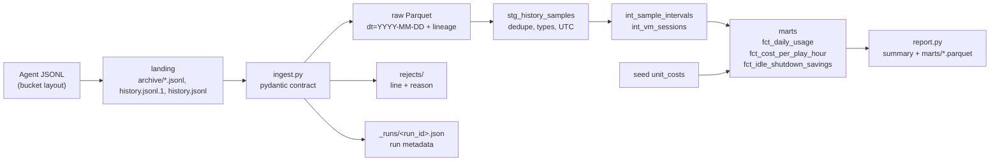

# PalPilot usage and cost analytics

A small, self-contained data pipeline that answers two questions about the Palworld server:

1. What does one play-hour cost?
2. How much does the idle shutdown save compared to leaving the VM on 24/7?

## About the data

The data is synthetic. The server is offline by choice: there is no GCP access, no BigQuery and no cloud cost, so there
is no real history to analyse. The generator simulates what the VM agent (`panel/panel.py`) would have written, in the
same bucket layout, so the pipeline is built and tested against the real contract. Pointing it at a real bucket means
copying the files into `analytics/data/landing/stats/` and skipping the generator. All numbers below come from
synthetic input and say nothing about real usage.

## Layers



| Layer | Where | What |
|---|---|---|
| landing | `data/landing/stats/` | Files exactly as the agent leaves them. The generator injects a truncated last line, a duplicated sample, out-of-range readings and null readings. |
| raw | `data/raw/history/dt=.../` | Valid rows only, with `source_file`, `line_no`, `run_id`, `ingested_at`. |
| rejects | `data/rejects/rejects.jsonl` | Every invalid line with its reason (`invalid_json`, `cpu:less_than_equal`, ...). |
| run metadata | `data/_runs/<run_id>.json` | Files read, rows read/valid/rejected, reasons, timestamps. |
| staging | `stg_history_samples` | One row per sample instant, typed, UTC timestamps. |
| intermediate | `int_sample_intervals`, `int_vm_sessions` | Gaps and islands: a gap over 5 minutes starts a new VM session. |
| marts | `fct_*` | Daily usage, cost per play-hour, idle shutdown savings. |

Data contract (`Sample` in `ingest.py`): every key is required; null is a valid reading (the agent never writes 0 for an
unavailable one); percentages 0 to 100; rates, fps, frametime and uptime at least 0; players 0 to 1000; `t` between 2023
and 2100; no extra keys; strict types.

Idempotency: ingest is a full refresh written to a temp directory and swapped in. The run id is a digest of the input
files and a replay keeps the original `ingested_at`, so the same landing input gives byte-identical raw output. The
second `make demo` produces identical raw Parquet and marts. The newest archive and `history.jsonl.1` are the same
generation (the agent archives a file, then renames it), so duplicates reach raw by design and staging dedupes by `t`.

## The two questions

Each sample stands for the time up to the next sample (one sample period, 60 s, when the gap is more than 5 minutes).

- VM hours: the sum of those intervals. Samples exist only while the VM runs, including the boot minutes (`up=false`).
- Play hours: time with at least one player. Null players (boot, REST failure) count as no players.
- Player hours: players times time.
- Cost = VM hours x hourly rate + fixed floor prorated per calendar day (monthly floor / 30), over every calendar day of
  the period, also days with no usage. Cost per play-hour is total cost over play hours; per player-hour likewise.
- Savings: always-on counterfactual (24 h x rate per calendar day) minus actual VM cost. The fixed floor is the same in
  both, so it is left out. The idle-grace tail (time after the last player, up to the watchdog stop) is shown as its own
  cost: the price of the 30-minute safety margin.

Cost assumptions (`dbt/seeds/unit_costs.csv`) are only the README estimates for Sao Paulo, approximate: about US$0.18 per
VM-running hour (compute + egress) and about US$14 per month fixed (static IP + disks). The README labels the first
figure per play-hour; here it is applied per VM-running hour, which is how it is billed. The 30 days per month is a
proration convention, not a price.

## Run

```bash
uv sync --locked --group analytics
make demo            # generate -> ingest -> dbt build -> report
make analytics-test  # contract, determinism, idempotency, end-to-end marts
```

Pieces: `python -m palpilot_analytics.generate --seed 42 --days 30 --start 2026-09-01`, then `ingest`, then
`dbt build --project-dir analytics/dbt --profiles-dir analytics/dbt`, then `report` (with `PYTHONPATH=analytics/src`).
`ANALYTICS_DATA` moves the data directory. The generator rotates by line count (the agent rotates at 8 MB, which a
30-day demo would never reach).

Example output of the default demo:

```
Usage and cost 2026-09-01 .. 2026-10-01 (26 days with usage; synthetic data)
  VM hours                    62.3
  Play hours (>=1 player)     48.6
  Total cost              $  25.68  (VM $11.21 + fixed $14.47)
  Cost per play-hour      $   0.53
  Savings vs always-on    $ 122.71  (91.6% of $133.92)
```
