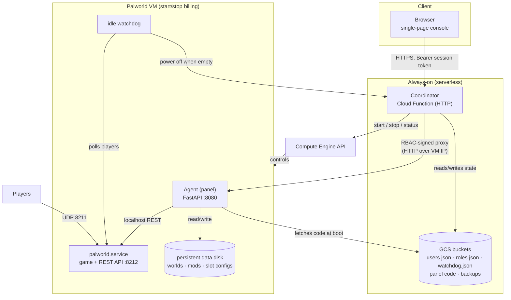
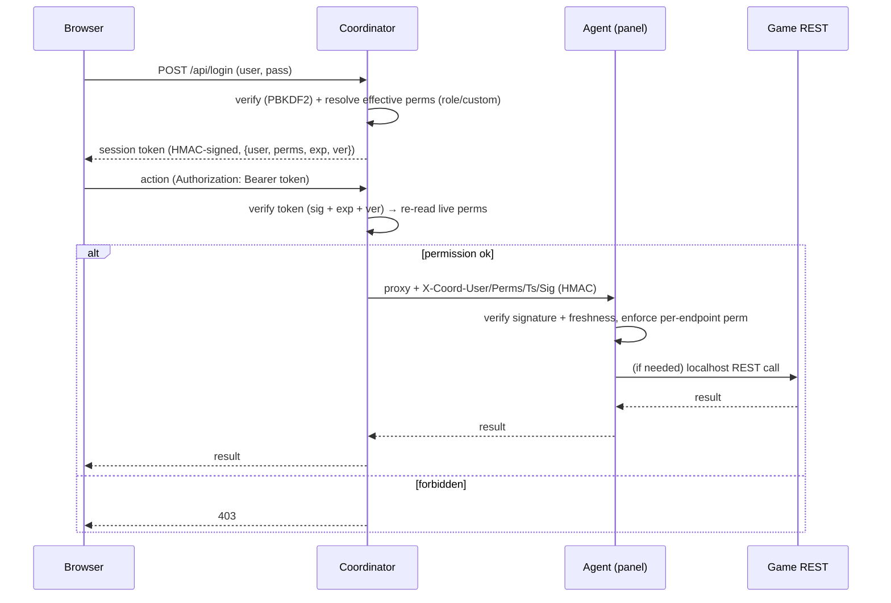
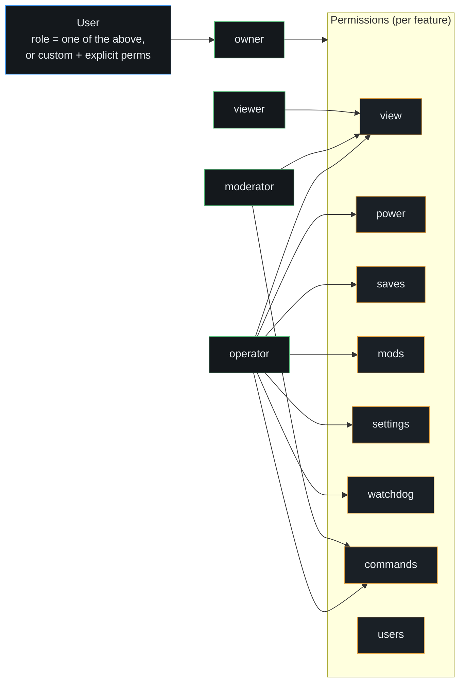
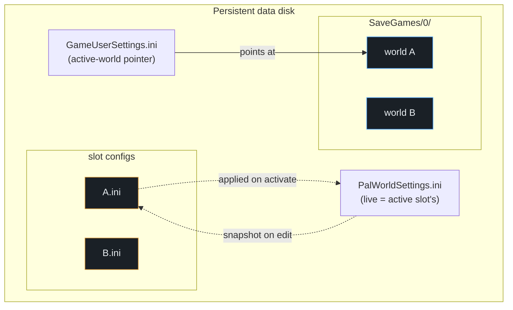
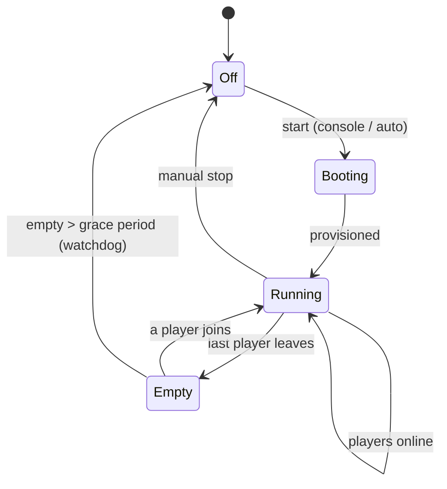
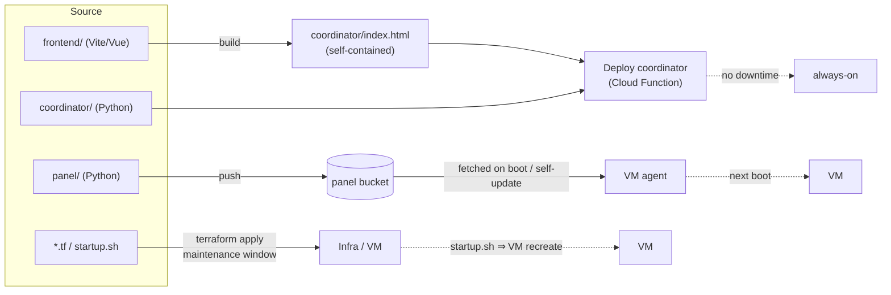

# PalPilot — Architecture

PalPilot is a two-tier control plane for an on-demand Palworld dedicated server on Google Cloud: a small,
always-on **coordinator** (serverless) and a **VM-side agent** (the "panel") that runs next to the game. The
expensive VM only runs while players are online; everything else is cheap or free.

---

## 1. System components

- **Coordinator** — hosts the console, authenticates users, owns users/roles/watchdog state, starts/stops the VM,
  and proxies permission-checked requests to the agent. Scales to zero when idle.
- **Agent (panel)** — does the file-level work on the VM: edit `PalWorldSettings.ini`, manage save slots and mods,
  take/restore backups, and proxy the Palworld REST API. Reachable only through the coordinator's signed proxy.
- **Persistent data disk** — worlds, mods, and per-slot settings; survives every power cycle and VM recreate.

---

## 2. Authentication & request flow

Login is HTTP Basic once; the coordinator then issues a signed, expiring **session token** the browser carries as
a Bearer header. When proxying to the agent, the coordinator signs the acting user's identity + permissions so the
agent can enforce the same permission model — the agent never trusts a raw shared credential from the open port.

- **Session token** — `base64url(header).base64url(payload).hex(HMAC-SHA256(...))`, hand-rolled (no JWT dep),
  signed with a shared secret. A per-user `ver` counter allows "sign out everywhere" and password-change invalidation.
- **RBAC propagation** — the `X-Coord-*` headers are a *separate* signed construction; the agent verifies them and
  enforces the granular permission for each endpoint, expanding any legacy coarse permission for safety.

---

## 3. Permissions & roles

Granular, per-feature permissions; roles are named bundles you assign to users.

Effective permissions resolve in one place: a user's role supplies the baseline; a `custom` role uses the user's
own permission list. The coordinator route table, the agent's per-endpoint checks, and the console's UI gating all
key off the same permission names.

---

## 4. Save slots & per-save settings

Each save slot is a world folder; the active one is selected by a pointer in `GameUserSettings.ini`. **Settings and
mods belong to the save, not the server** — each slot carries its own `PalWorldSettings.ini`, swapped into the live
config when the slot is activated.

**Activate a slot:** stop → back up current world → snapshot current settings to the outgoing slot → switch the
pointer → apply the target slot's settings → re-assert REST/admin keys (so the panel↔game link never breaks) →
start. Clone copies the settings with the world; delete removes them.

---

## 5. Idle lifecycle (cost control)

The watchdog polls player count on the VM; when the server has been empty past the grace period it asks the
coordinator to power the VM off. Worlds/mods persist on the data disk for the next boot.

---

## 6. Deployment paths

Different parts ship differently — deliberately, so day-to-day changes never touch the live VM.

- **Coordinator + console** → redeploy the Cloud Function (zero downtime). GitHub Actions does this on push.
- **Agent** → push to the panel bucket; the VM fetches it on next boot (or self-update). No live restart from CI.
- **Infra** → `terraform apply`. Editing `startup.sh` forces a VM recreate, so it's a planned, maintenance-window
  action; the persistent data disk is preserved across the recreate.

See **[`CICD.md`](CICD.md)** for the automated pipeline.
